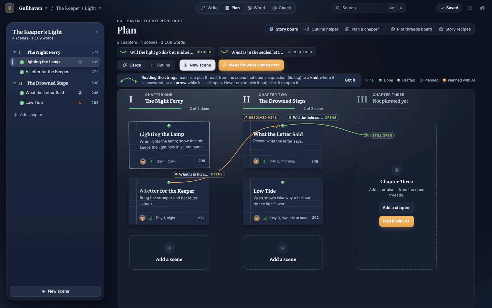
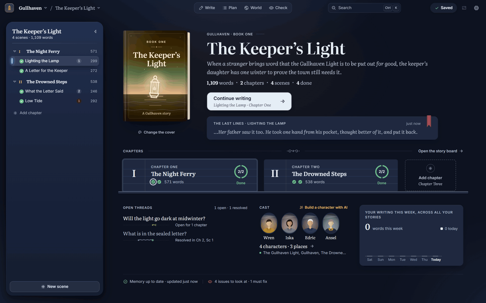
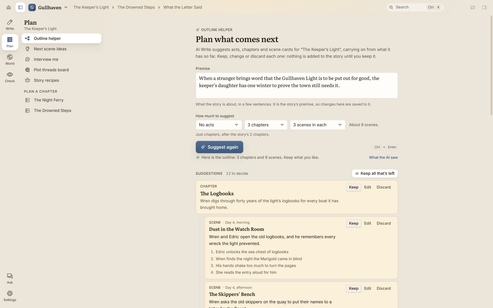

# Planning

Some writers plan every scene before they start. Others find the story as they go. AI Write works either way.
This page covers outlining a story, planning chapters and scenes, starting new stories in the same world, setting
the style, and story recipes.

## The story board

The **Plan** room opens on the **Story board**: every scene as an index card, a column for each chapter, with the
plot threads as strings from the scene that opens a question to the scene that answers it. **Cards** and **Outline**
switch between the board and a list. Drag a card to move a scene. **New scene** adds one, and
**Ideas for what comes next** suggests the next scenes. The column after the last chapter has **Add a chapter** and
**Plan it with AI**.

The **story home** (the lamp at the top left of the top bar, or the story's name) shows the book as a whole: its
cover, **Continue writing**, the last lines you wrote, the chapters, open threads, the cast and this week's writing.

## Build a story with the AI (the Story builder)

The **Story builder** is one place to build a whole story from your idea. Open it from the story menu (the arrow
beside the story's name), from **Story builder** in the **Plan** room, with Ctrl+K, or by ticking **Build it with the
AI next** when you make a new story. To start a brand-new story in it, choose **Build a story with AI…** on the start
screen and pick a world. Its steps run across the top, and you can go back to any of them:

1. **Your idea.** Write your plot, as long as you like. Add where it's set, what must happen, what must never happen
   and how long it is. Under **Your own characters, places and more**, add anyone you already have in mind: the AI
   keeps them exactly as you wrote them. **Ask me questions** has the AI ask about what you left open. On the right,
   choose **This story's style**: a preset (open **For adult readers** for steamier, darker or more violent ones), how
   far it goes, and the tone. **Follow a recipe** uses the shape of a story you admire.
2. **Cast and world.** Click **Plan the cast and world**. The AI lists every character, place, group, object, piece
   of lore, event, plot thread and word your story needs, with yours first. Untick, **Edit**, **Redo** (with a note
   about what to change) or remove any of them, or tell it what to change in **Talk the cast and world over**. Then
   **Build** writes a full page for each one in your codex. **Undo build** takes the whole build back.
3. **Outline.** The Outline helper, planning from your idea and the cast it just built. With no premise, it writes
   one first for you to keep.
4. **Done.** What was made, and **Start writing**.

### Talk it over, or redo one part

Beside the suggested outline, **Talk it over** lets you tell the AI what to change ("make chapter 3 a betrayal",
"rework the rest to fit my changes"). It shows you the new plan first: **Apply** puts it in, **Decline** leaves things
as they were, and Undo takes an applied change back. Things you've kept are never changed. The AI rewrites only the
parts your request affects, so small changes come back quickly. If you reply while a change is still waiting ("it
still says his bedroom"), the AI fixes that change instead of starting over. The preview shows only what changed, the
old words struck through (**Show the whole plan** for the rest), and each answer lists the parts it changed. Tick
**Apply changes straight away** to skip the preview; Undo still takes a change back.

Each suggestion still waiting has **Redo**: say what should be different (or leave it empty for a fresh take), then
**Use this** or **Keep mine**. Only that act, chapter or scene changes.

## Outline a story

The **Outline helper** suggests acts, chapters and scenes from your premise. It is the Story builder's outline step.

1. Open the **Plan** room and choose **Outline helper** in its links (or choose it from the story menu, the arrow beside the
   story's name in the top bar, or search for it with Ctrl+K). In an empty story, **Plan it with the outline helper**
   at the foot of the binder does the same.
2. In the **Premise** box, describe what the story is about. A few sentences are enough.
3. Under **How much to suggest**, choose how many acts, chapters and scenes in each chapter you'd like.
4. Click **Suggest an outline**. The suggestions arrive one by one.
5. Click **Keep**, **Edit** or **Discard** on each one, or **Keep all that's left**. Nothing is added to the story
   until you keep it.

The page is called **Plan the story from its premise** in a new story. In a story that already has chapters, it's
**Plan what comes next**, and the suggestions carry on from what's there.

What you keep becomes real chapters and scenes in the binder, each with a scene card ready to draft from.

## Plan a chapter

1. In the Plan room, choose the chapter under **Plan a chapter**, or open a chapter's menu in the binder and choose
   **Interview me about this chapter**.
2. Choose **Plan a chapter** to answer a few questions about it, or **Just suggest scenes** to go straight to scene
   cards suggested from the chapter and the outline around it.

## Get ideas for a scene

Stuck on what happens next?

- **Ideas for this scene**, on the scene card, offers three possible directions from the outline, the open plot
  threads and the story so far. Click **Suggest ideas**, then **Use this** on the one you like.
- **Interview me about this scene** asks you questions, then fills in the scene card from your answers.

Both are also in search (Ctrl+K).

## Start a new story in the same world

A world can hold many stories: a series, a prequel, a side story. Each one knows what it should about the others.

1. Choose **New story…** on the start screen (or from the story menu, the arrow beside the story's name in the top bar).
2. Give it a title, and a **Series** if you like.
3. Choose how it fits with your other stories:
   - **Continues after**: starts after that story ends and knows everything before it.
   - **Side story during**: runs alongside that story. Later books know what happened in it.
   - **Prequel to**: set before that book but written after it. The book stays as written.
   - **Own version of events**: a "what if" that doesn't change the others.
4. If there's a long gap in time, say so. The AI fills in what changed in between.
5. Click **Create**.

Different worlds never read each other, so nothing leaks between them.

Each story has its own **Story settings** (in the story menu), for its premise and where it starts.

## Set the style

The **Style guide** tells the AI how your story should read. Open it from the **Write** room's links, or search (Ctrl+K)
for **Style guide**.

At the top, **Applies to** shows the three levels:

- **My preferences**: your own defaults, for everything you write. (These live in
  **Settings › My writing preferences**.)
- **World**: for every story in this world.
- **This story**: just for this book.

Each level can change what the one above says.

### Story feel

- **Start from a preset**: one click sets the genre, how far it goes, point of view, tense and prose style, such as
  **Cosy mystery**, **Pacy thriller** or **Lyrical literary**. **For adult readers** opens presets such as **Steamy
  romance**, **Dark romance**, **Grimdark**, **Hardboiled noir** and **Erotica**. Change anything after; Undo puts the
  style back. Set it on the **This story** tab (or in the Story builder) to give one story its own style.
- **Genre**: pick up to two tiles, such as Fantasy, Mystery or Cosy.
- **How far it goes**: set **Romance**, **Violence** and **Language**, from **None** or **Off-page** up. For example,
  romance goes from **None** to **Fade to black**, **On the page** and **Explicit**.
- **Steer clear of common AI phrases** (on by default) asks the AI to avoid stock phrases.

### How it's written

- **Point of view**, **Tense** and **Spelling** (UK or US).
- **Prose style**: describe how the prose should sound, in your own words.
- **Sample passage**: paste a paragraph that sounds the way you want. This is the single best way to make drafts
  sound like you. Don't have one? **Write a sample for me** writes about 200 words in the style on screen.
- **Phrases to avoid**: words and phrases you never want to see. Live checks underline them too.

## Story recipes

A recipe is a story's themes, writing style and structure, without its words. Use one to write a new story with the
shape and feel of one you admire.

### Make a recipe

1. Open **Story recipes** from the start screen, the **Plan** room's links, or search (Ctrl+K).
2. Choose **Make a recipe from a story**.
3. Bring the story in **From a file**, or **Paste the text**.
4. The **Recipe maker** model reads it and writes the recipe: what it's about, how it's written and how it's built.

The story's text is sent only to the recipe maker model, and only while the recipe is made. On the recipe's page,
**Forget the story's text** removes the copy AI Write kept. You can also **Write one yourself**.

### Write from a recipe

- On a recipe's page, click **Start a new story from it**.
- Or, on the start screen, choose **New story from a recipe…** (it appears once you have a recipe).
- Or, in the Story builder's first step, choose it under **Follow a recipe**. Its cast roles become characters in the
  cast and world step, and the outline follows its shape and beats.

### Change a recipe

Edit any part of a recipe on its page, click **Redo** beside a part to have the AI write it again (with a note if you
like), or tell the AI what to change in **Talk the recipe over**. You see each change before it's made. In the Story
builder, changes are for that story only, until you click **Save changes to the recipe**.

---

**Next:** [Read aloud and dictation](read-aloud-and-dictation.md)
