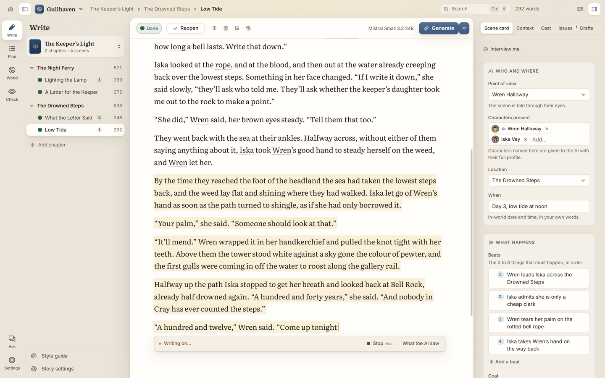
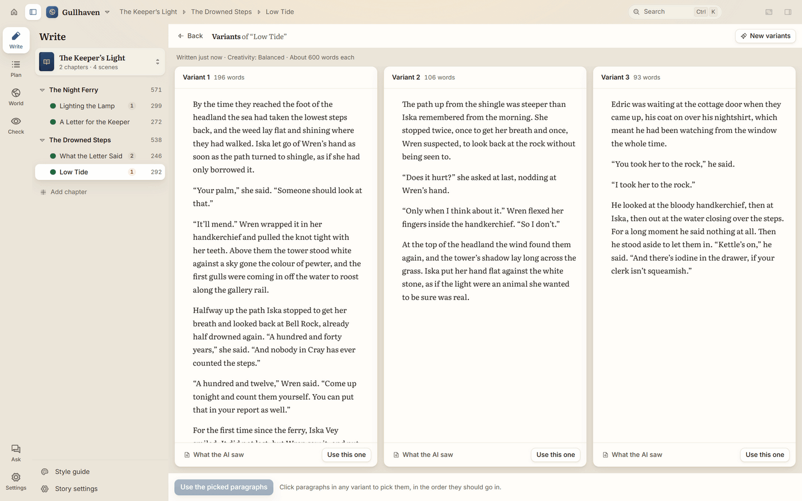

# Writing with AI

AI Write can draft a whole scene, carry on from where you are, rewrite a few words, or offer you two or three
versions to pick from. Whatever it writes, you decide what stays. This page shows each way of writing with AI,
and the tools for writing by hand.

## The AI dock

The AI dock sits at the foot of the page:

- **Steer the next bit… (optional)**: a note for the next thing the AI writes, such as "Iska notices the blood".
  Press Enter in it to continue with that note.
- **Add below**: a new draft below a scene break.
- **Continue** (Ctrl+Shift+Enter): the AI writes on from the end of the scene. In an empty scene the button says
  **Draft the scene** and drafts it from its card.
- **More**: **Rewrite the scene**, **Fresh take**, **Draft three**, **Beat by beat** and **Draft options…**, then
  the scene's tools: **Mark done**, its status, **Ask the world**, **Scene history** and **Format**.

While the AI writes, the dock shows how many words so far, the model, and **Stop**. When it's done, the dock has
**Accept** (Tab) and **Reject** (Esc). Above the dock, a small chip shows the **Next beat** from the scene card.

If you use the **Panels** layout, the same tools are in the toolbar above the page.

## Plan the scene on its card

The AI drafts from the scene card. Open it with **Scene details** under the scene's title or in the top bar. The more it says, the closer the draft will be to
what you have in mind, but a few lines are enough.

- **Who and where**: the **Point of view** character, the **Characters present**, the **Location**, and **When**
  ("In-world date and time, in your own words", such as "the evening of the first storm").
- **What happens**: **Beats** (click **Add a beat** for each step), and the scene's **Goal**, **Conflict** and **Outcome**.
- **Plot threads**: which threads the scene **Sets up** or **Pays off**.
- **How it reads**: **Mood or tone**, **Length**, and **Notes for the AI**.

AI Write keeps a story calendar from the **When** on each card. Write it however you like: "Day 12, dusk", "3 March
1820", "the next morning" or "three weeks later". AI Write counts on from the scenes before, so under **When** you may see
how it read yours, such as "Reads as Day 4 · morning." On the story board, a When like "The next morning" shows its day
beside it. Before each draft, the AI is told the date, how long it is since the scene before, and how old the people in
the scene are when their **Age or birth date** says enough ("born 1790", or "34 at the start of the story"), so it
doesn't have to work it out. If a scene goes back in time, start its When with "Flashback" (or "Earlier"). Otherwise
the card asks "Earlier than the scene before. A flashback?"

For "Lighting the Lamp" in Gullhaven, the beats might be: Wren climbs the hundred and twelve steps; the lamp
won't catch; she sees the night ferry's lights early.

## Generate a draft

1. Open the scene from the story's spine.
2. Click **Draft the scene** in the AI dock (or press Ctrl+G).
3. The draft appears in the page as it's written. Click **Stop** or press Esc at any time; the text so far is kept.

Before it writes, the AI is briefed from your world: the characters in the scene and what they know, the places,
the rules that must never be broken, a summary of the story so far, earlier passages that matter, and your style
guide. You don't need to set any of that up for each scene.

### When the scene already has text

If the scene has words already, choose where the new draft goes:

- **Rewrite the scene** (under **More**): the new draft takes the place of what's there.
- **Fresh take** (under **More**): a new attempt that ignores the current text.
- **Add below** (on the dock): the new draft goes below what's there.

Ctrl+G in a scene with words asks **Where should the new draft go?** with the same choices.

Either way, Ctrl+Z undoes it.

### Draft options

Choose **More** › **Draft options…** in the dock:

- **Direction for this draft (optional)**: a note just for this draft, such as "Make it tense, end on the knock at
  the door".
- **Length**: leave it on Auto and the AI picks the length the scene needs, or type a number of words.
- **Creativity**: **Steady**, **Balanced** or **Adventurous**.
- **Polish after drafting**: once the draft is written, the writer model reads it again and polishes it. It's off
  by default and costs about twice as much.

## Accept or reject the AI's changes

When the AI writes or changes words, the change shows in the page in amber, with **Accept** and **Reject** on the
dock.

- Press **Tab** to accept.
- Press **Esc** to reject, or to stop a change while it's being written.

Nothing changes until you accept.

## Continue

Click **Continue** in the dock (Ctrl+Shift+Enter) and the AI writes a paragraph or two on from the end of the scene,
shown as a change to accept or reject.

To carry on from somewhere in the middle, click there, press Ctrl+K, type "continue", and choose
**Continue from the cursor**. You can also select some words, click
**Rewrite**, and choose **Continue after these words**.

## Rewrite selected words

1. Select the words you want to change. A small bar appears above them.
2. Click **Rewrite**.
3. Type how to rewrite them in the box ("Say how to rewrite it…"), or pick one of these:
   - **Expand**: more detail, same moment.
   - **Condense**: fewer words, same meaning.
   - **More vivid**: sharper senses and verbs.
   - **Change tone**: pick a tone or describe your own.
   - **Fix voice**: match each speaker's voice (shown when the words include dialogue).
   - **Alternatives**: three versions to pick from.
4. Accept or reject the change.

The same bar also has **Ask about this** (asks Ask the world about the words), **Add to memory** and
**Quick start a character**.

## Write two or three versions side by side

1. Choose **More** › **Draft three** in the dock.
2. Click **Write three variants** (or two).
3. Read them side by side. Click **Use this one** to take a whole version, or click the paragraphs you like from
   each and choose **Use the picked paragraphs**.

## Write beat by beat

For close control, the AI can write one beat of the scene card at a time.

1. Choose **More** › **Beat by beat** in the dock.
2. After each beat, you can add a note in "Anything to change for the next beat?".
3. Click **Write the next beat**, or **Write it again** to redo the last one.
4. Click **Finish** when you're done.

To stop for a while, click **Back to the AI bar**. Later, **More** › **Beat by beat** picks up at the next beat. If
the scene already covers its first beats some other way (you wrote them yourself, or rewrote them), Beat by beat
offers **Carry on from beat N**, the same next beat the **Next beat** chip shows.

While you write beat by beat, a band marks where each beat begins. Point at a beat and click its **Beat N** label to
redo it (with a note if you like), see what the AI saw, or remove it. An earlier beat comes back as a tracked
change: **Accept** or **Reject** it. If you typed your own paragraphs inside that beat, the change says it replaces
them too, so you can reject it. To keep the markers after **Finish**, turn on **Show beats** in **Settings ›
Editor**. Starting a new beat by beat session on the scene replaces the old markers.

## Small slips are mended for you

With **Check new words straight away** on (it is by default, in **Settings › Models**), new AI words are checked as
they land. Small slips, like a character's eye colour drifting, are fixed in amber with a note
"Mended a slip in the new words, in amber", and an **Undo**. Anything bigger is raised for you to look at in
the **Issues** tab.

## Each scene keeps to its contract

With **Give each scene a contract** on (it is by default, in **Settings › Models**), every draft is written to a short
list: what must be true at the start (where people are, what they hold, how much time has passed), what must change
(the scene card's beats, or what you asked for), and what must not change (who is dead, what is kept from someone,
injuries). When the new words go against it, or don't yet show something the scene was meant to bring about, it is
raised in the **Issues** tab, marked **Scene contract**, with a rewrite of just that sentence when one would put it
right. Nothing changes without you. (**Write the whole chapter** puts right what goes against the list once a second
look agrees, as it does its other fixes; something not shown yet is always left for you.) The check report at the top of
the Issues tab says how the latest draft kept to the list, item by item, and the **Context** tab shows the list the AI
was given.

## A brief before each scene

With **Write a continuity brief before each scene** on (it is by default, in **Settings › Models**), the memory model
reads far more than the writer could just before each draft: everything the story's record says about the people,
places and things in the scene, who knows what, the promises still open, the story calendar, how each chapter so far
ended, the passages that may matter, and, when it can read that much (DeepSeek's models can), the book so far itself
(in a long book, its latest chapters). It hands the writer a short brief: what matters for this scene, what must not be
contradicted (with the chapter and scene it comes from), who knows what among the people there, the promises in play,
and how long it has been since the events that matter. The parts of the briefing it covers, such as the older story so
far and the earlier passages, go in their short form, so the briefing doesn't grow. Anything you keep out of a scene in
the **Context** tab stays out of its brief too. It comes from the plan's own call, so it needs **Plan before writing**,
and a draft may take a little longer to start. The **Context** tab shows the last brief written for the scene.
Generate, Add below and **Write the whole chapter** get one for each draft; Beat by beat writes one for the scene with
its first beat and uses it for the rest; Continue doesn't get one.

## See what the AI saw

**What the AI saw** shows exactly what was sent for a draft or a change: the model, how many tokens it read and
wrote, what it cost, the whole briefing, and what came back. If a draft replaced text, **Put it back** brings the old
text back.

You'll find it in the **Drafts** tab, in **Scene history**, and under AI changes in the page.

## Keep earlier drafts

- The **Drafts** tab in the scene panel lists the scene's drafts. **New draft** starts a fresh one, and
  **Switch to it** moves between them.
- **Scene history** (in the dock's **More** menu) keeps earlier versions of the scene: before every AI change, when you mark the scene
  done, and every so often while you write. Pick one to compare it with the scene now, then
  **Restore this version** if you want it back. Your current text is kept, so you can undo it.

## Mark a scene done

Press Ctrl+Enter, or choose **More** › **Mark done**, when you're happy with a scene. Once every beat on the card is
written, the chip above the dock offers **Mark done** too. AI Write reads it, updates the memory, writes its
summary, and checks it for consistency. The scene's dot in the binder turns to **Done**. **More** › **Reopen the scene** reopens it.

## Write by hand

You never have to use the AI. Everything you type saves as you go (Ctrl+S saves straight away, if you like).

- **Formatting**: Ctrl+B for bold, Ctrl+I for italic, Ctrl+Shift+B for a quoted passage. **More** › **Format** in
  the dock has these and **Scene break**. Ctrl+Shift+V pastes without formatting.
- **Find and replace**: Ctrl+F in this scene, Ctrl+Shift+F in the whole story, with **Match case** and
  **Whole word**.
- **Spelling**: misspelt words are underlined. Right-click one for suggestions. The names in your world count as
  correct. Turn it off in **Settings › Editor**.
- **Right-click menu**: right-click in the page for **Ask about this paragraph** and, when read aloud is on,
  **Listen from here**. Select some words first and it offers **Ask about this**, **Edit this** and the AI tools
  under **Rewrite** (Expand, Condense, More vivid, Change tone, Alternatives, Continue after these words), the same
  as the bar over selected words. Cut, Copy and Paste are at the foot.
- **Word counts**: click **Saved** in the top bar (it shows the scene's words) for the word counts and today's
  writing. Set a daily target in
  **Settings › Editor** under **Daily word target**.
- **Focus mode**: press F11 and only the page shows. Press Esc or F11 to leave.

> **Tip:** the AI writes in the style you set in the **Style guide** (see [Planning](planning.md#set-the-style)).
> If drafts don't sound like you, put a paragraph of your own writing in its **Sample passage**.

---

**Next:** [Your world](your-world.md)
